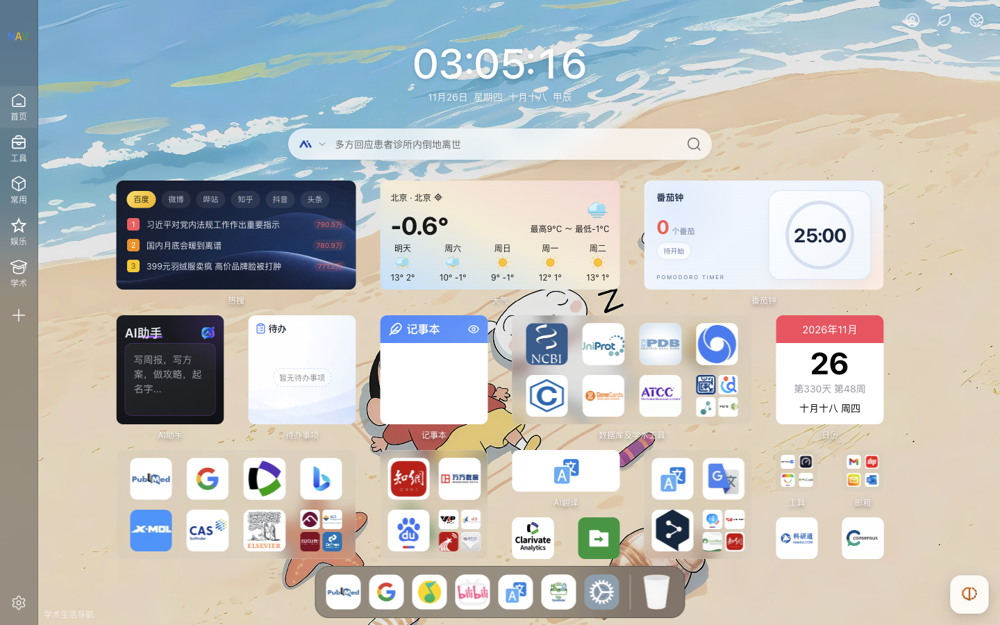

# zTab

zTab 是一个参照 [nav.peptide.ink](https://nav.peptide.ink/) 重建的 Vue 3 学术生活导航页，保留原站的海滩壁纸、侧边分类、时钟搜索、卡片布局和底部快捷栏。源代码可以直接修改，图片保存在本地。



## 启动

需要 Node.js 20.19+ 或 22.12+。

```bash
npm install
npm run dev
```

访问终端显示的本地地址，默认是 `http://127.0.0.1:5173/`。

```bash
npm run build    # TypeScript 检查与正式构建
npm run preview  # 预览 dist 构建产物
```

`dist/` 可以部署到任意静态网站托管。没有数据库或服务器依赖。

## 已实现

- 5 个分类，252 条公开网站书签、24 个组件/文件夹，以及 7 个底部快捷入口。
- 原站的桌面网格尺寸与排列：60 px 图标、35 px 列间距、12 px 行间距，支持 1×1、1×2、2×2、2×4 卡片。
- 秘塔 AI、百度、Google、必应、Google 学术、PubMed 搜索；输入时检索本地书签。
- 文件夹展开，新增与编辑书签/文件夹/分类，回收站恢复，批量模式拖动排序，编辑窗前移/后移。
- 待办新增/完成/删除、自动保存的记事本、可暂停的番茄钟、阳历和农历日历。
- 壁纸上传、预设背景、遮罩与模糊调节、简约模式、图标间距与快捷栏设置。
- JSON 备份导出和导入；导入前确认替换，无效数据不会覆盖原有数据。
- 图片格式转换、金额大写转换、电子木鱼、随机选餐；AI 卡片打开外部 AI 服务。
- 手机端底部分类栏，避免原站侧栏遮住内容。桌面端保持参考布局。

右键标签进行编辑；右键桌面空白处打开菜单。按 `/` 聚焦搜索，按 `Esc` 关闭弹窗。

## 数据和边界

当前版本是可独立运行的前端复刻。个人数据保存在当前浏览器的 `academic-navigation:v1` 键中。清除站点数据会清除个人修改，请通过「数据管理」导出备份。

天气和热搜使用 **2026-11-26 的公开参考快照**，不是实时接口；天气详情和热搜链接可以打开实时来源。知乎当次未返回榜单，提供原始热榜入口。时钟与日历实时计算。未接入原站账号系统、云同步、管理后台或 AI 代理服务。

原站的备案号、联系方式、统计脚本和第三方浏览器扩展悬浮按钮不属于本项目。桌面首屏主要布局与原站一致，弹窗使用重新实现的交互，移动端修正了遮挡问题，因此不宣称整个网站的全部行为完全相同。

## 修改位置

| 文件                                  | 用途                               |
| ------------------------------------- | ---------------------------------- |
| `src/App.vue`                         | 页面布局、搜索、分类、书签编辑     |
| `src/style.css`                       | 样式、卡片尺寸、响应式断点         |
| `src/state.ts`                        | 状态、存储、导入校验、回收站、计时 |
| `src/components/NavTile.vue`          | 书签、文件夹、组件卡片容器         |
| `src/components/WidgetCard.vue`       | 首页各个小组件                     |
| `src/components/UtilityPanel.vue`     | 待办、记事本、计时与工具弹窗       |
| `src/components/SettingsPanel.vue`    | 外观、数据管理、项目说明           |
| `src/data/navigation.json`            | 默认分类、书签和 Dock 数据         |
| `src/data/theme.json`                 | 壁纸、Logo 和组件图片路径          |
| `src/data/feeds.json`、`weather.json` | 热搜和天气快照                     |
| `public/assets/reference/`            | 本地图标及壁纸                     |

如果已在浏览器中保存个人数据，修改默认 JSON 不会覆盖这些数据；使用新的浏览器环境查看新的默认值，或先导出备份再清除本项目的存储键。

GitHub 调研见 [docs/开源项目调研.md](docs/开源项目调研.md)，素材来源见 [THIRD_PARTY_NOTICES.md](THIRD_PARTY_NOTICES.md)。
